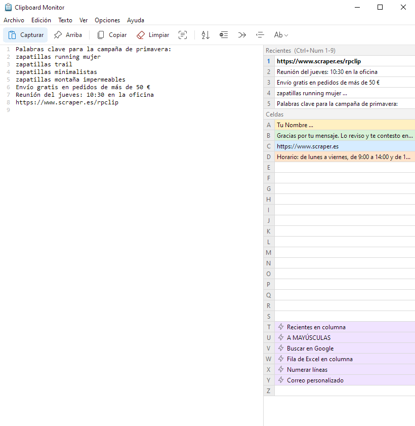

# rpclip — Clipboard Monitor for Windows

rpclip keeps everything you copy, lets you store snippets in 26 cells (A–Z) and runs small
automation scripts. A single portable `.exe` (under 1 MB), no installer, no internet connection, no
telemetry. Interface in English, Spanish and French.

> [Download the latest version](../../releases/latest) · Windows 10 / 11, 64-bit · [Página en español](https://scraper.es/rpclip/)

## Features

- **Clipboard history**: every text you copy is added to the log, plus the last 9 copies in the
  *Recent* list. Paste any of them from any program with Ctrl+Numpad 1–9.
- **Cells A–Z**: snippets you use often (signatures, addresses, templates), with colours,
  preview on hover and drag & drop to reorder.
- **Scripts**: a cell can type text, press keys, click, drag, scroll, wait for a window, open
  programs and loop over the lines, fields or blocks of the clipboard. Comes with a visual editor
  that records clicks and screen positions.
- **Read text from the screen (OCR)**: Ctrl+Alt+O, select an area and the text goes to the
  clipboard. Uses the OCR built into Windows, nothing is sent anywhere.
- **Line by line pasting**: Ctrl+Alt+Down pastes the current line and prepares the next one;
  Ctrl+Alt+Left/Right moves through the captured lines.
- **Text tools**: sort, remove duplicates, remove blank lines, trim, change case.
- **Tray icon, start with Windows, global shortcut to show it** (Ctrl+. by default).

Press F1 in rpclip for the full manual.

## Install

1. Download `rpclip-win64.zip` from [Releases](../../releases/latest).
2. Unzip it into any folder (for example `C:\Tools\rpclip`) and run `rpclip.exe`.

rpclip is portable: its settings (`rpclip.ini`) and your cells (`rpclip-celdas.txt`) are saved
next to the exe. To uninstall, untick *Options > Start with Windows* and delete the folder.

**"Windows protected your PC"**: the exe is not digitally signed yet, so SmartScreen may warn the
first time. Click *More info > Run anyway*.

## Privacy

Everything stays on your computer. The history is kept in memory and is lost when rpclip closes;
only the cells you save are written to disk, as plain text.

---

## En español

rpclip guarda todo lo que copias, te deja tener textos fijos en 26 celdas (A–Z) y ejecuta
pequeños scripts de automatización. Un solo `.exe` portable, sin instalación ni conexión a
internet. Descárgalo en [Releases](../../releases/latest), descomprímelo en cualquier carpeta y
ejecuta `rpclip.exe`. Pulsa F1 para ver el manual.

---

rpclip © R. Porcar. Free to use, see [LICENSE.txt](LICENSE.txt). Third-party licenses: `THIRD-PARTY-NOTICES.txt` in the download.
